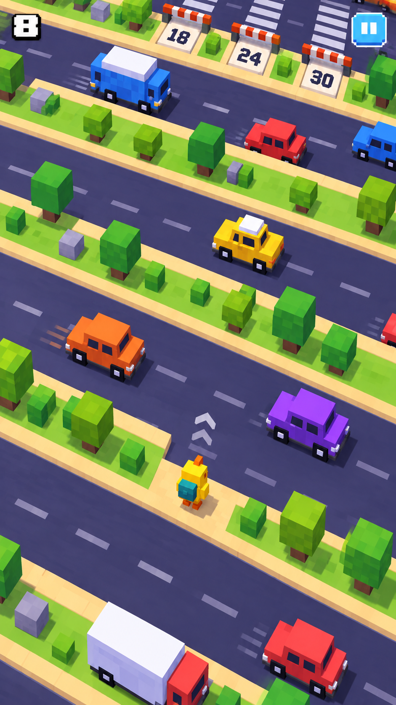
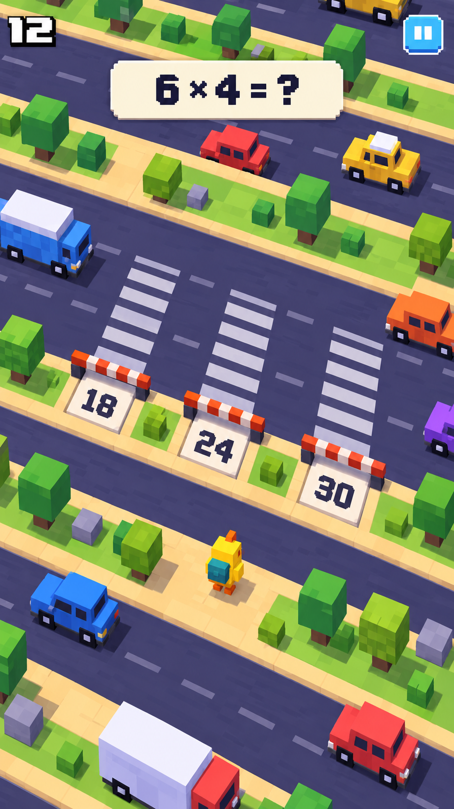
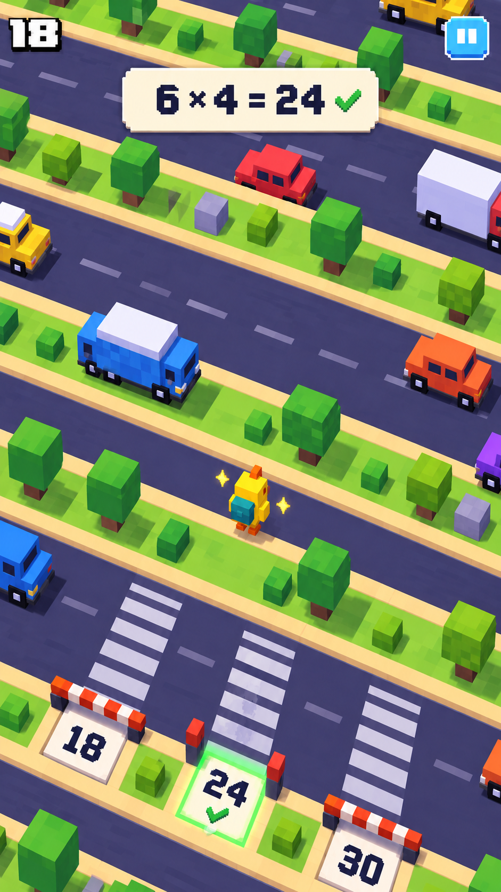

# 구구단 건너기 — 세로형 스토리보드 v2

첨부한 길건너 친구들 화면을 참고해 세로형 모바일 게임 화면으로 재구성했다.

- 화면: 약 9:16 세로 화면. 월드가 화면 전체를 채운다.
- 카메라: 위에서 비스듬히 내려다보는 고정 시점. 작은 캐릭터를 화면 하단 부근에 두고 위로 진행한다.
- 맵: 비스듬히 가로지르는 도로와 안전지대를 반복하고, 카메라가 전진에 따라 따라간다.
- UI: 좌측 상단 거리, 우측 상단 일시정지. 문제 구간에서는 상단에 구구단 문제를 표시한다.
- 답안: 세 갈래 횡단보도 입구의 바닥 숫자 `18 / 24 / 30`으로 표현한다.
- 게임 흐름: 차를 피해 전진 → 안전지대에서 문제 확인 및 정답 길 선택 → 정답 입구를 열고 차가 없는 순간 건너기 → 다음 도로.
- 생성: built-in image_gen. 기존 가로형 산출물은 유지하고 새 버전으로 저장했다.

## 1장 — 차를 피하며 전진

## 2장 — 문제 확인과 건널목 선택

상단의 `6 × 4 = ?`를 보고, 맵 안에서 `24`가 적힌 중앙 건널목으로 이동한다.

## 3장 — 정답 길 통과 후 다음 구간

중앙 입구가 열리고 `24`에 정답 표시가 뜬다. 차량 사이를 보고 건넌 뒤 카메라가 전진한 장면이다.

[생성 프롬프트](prompts.md)
