# 구구단 건너기 검증

- 전체 자동 테스트: 163개 통과, 실패 0개.
- JavaScript 문법 검사와 git diff --check 통과.
- 실제 브라우저에서 로비 카드 → 시작 → 이동 → 문제 선택 → 성공/종료 → 기록 저장 확인.
- 오답으로 하트가 3 → 2 → 1 → 0이 되면 즉시 종료. 종료 기록은 한 번만 저장됨.
- 보호막이 오답 1회를 막고 사라지는 것, 힌트 단서 표시, 오답 길 1개 제거, 차량 8초 감속 확인.
- 일시정지 중 캔버스와 차량 이동이 멈추는 것 확인.
- 실제 입력 이벤트로 화면 탭, 터치 스와이프, 키보드 이동 확인.
- 390×844, 320×568, 데스크톱 화면 확인. 320px 폭에서도 가로 넘침 없고, 조작 버튼은 44×44px.
- 구구단 3개 뒤 미국의 수도 문제와 국기·수도 보기 표시 확인.
- 마지막 캐나다 수도 문제까지 건너 총 6개 성공: 1060점, 별 3개, Sparkles +10, 서버 기록 저장 확인.
- 브라우저 오류와 처리되지 않은 Promise 오류 없음.

실제 데이터와 분리된 /tmp/times-crossing-qa DB와 8017 포트에서 검증했다.

## 수평·수직 화면 구성 확인 (2026-10-17)

- 도로, 잔디, 횡단보도, 표지판, 차량에 회전이나 기울임을 적용하지 않는다.
- 차량 4종에 좌우 주행 방향별 원본 프레임을 적용하고 지면 깊이순으로 캐릭터 앞뒤에 그린다.
- 390×844에서 캐릭터가 오른쪽 한 칸 이동할 때 x는 52px, y는 0px 변하는 것 확인.
- 실제 플레이로 첫 정답 길을 건너 하트 3개를 유지한 채 건널목 1개 완료 확인.
- 320×568에서 가로 넘침 없음, 캔버스 두 레이어 크기 일치, 방향 버튼 44×44px 확인.
- 브라우저 오류 및 처리되지 않은 Promise 오류 없음.

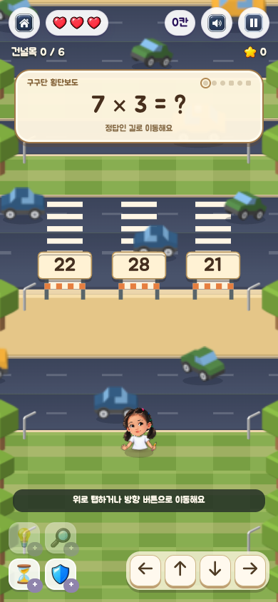

## 퀴즈 건널목 두 칸 이동 확인 (2026-10-17)

- 구구단·수도 퀴즈 건널목 6개 모두 정답 길 진입 → 맞은편 안전지대까지 두 번 전진하면 완료된다.
- 횡단보도 도로를 한 줄로 줄이고, 다음 구간의 도로·문제 위치와 결승선을 함께 당겼다. 마지막 안전지대는 40칸, 모두 통과 시 1000점이다.
- 실제 390×844 브라우저에서 3행(완료 0) → 4행(완료 0) → 5행(완료 1) 이동을 확인했다. 하트 3개 유지, 브라우저 오류 없음.
- 여섯 건널목 모두 두 번의 이동으로 완료되고, 돌아갔다 재통과해도 중복 점수가 없는 것을 자동 테스트로 확인했다. 전체 137개 테스트 통과.

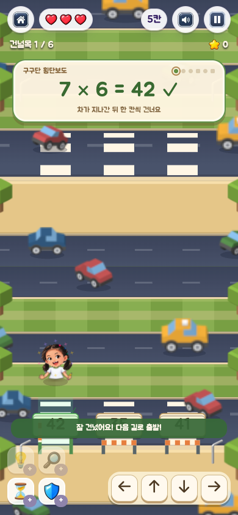

## 펜스 제거 및 답변 상자 위치 조정 (2026-10-17)

- 주황색·흰색 펜스와 양쪽 지지 기둥, 정답 선택 후 올라가던 차단봉을 제거했다.
- 답변 상자와 글자·정답 체크 표시를 기존 위치보다 월드 좌표 기준 36px 내려 펜스가 있던 입구에 배치했다.
- 390×844 화면에서 퀴즈 입구까지 실제로 이동해 세 상자의 숫자가 읽히는 것과 브라우저 오류가 없는 것을 확인했다.
- 게임 규칙 테스트 17개, JavaScript 문법 검사, git diff --check 통과.

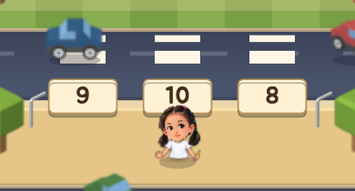

## 박스형 차량 이미지 시트 적용 (2026-10-17)

- 내장 image_gen 도구로 단순한 박스형 차량 8종·양방향 16개를 1448×1086 RGBA 시트로 제작했다.
- 빨강 소형차, 파랑 승용차, 초록 SUV, 보라 밴, 노랑 택시, 주황 버스, 트럭, 민트 스쿠터를 한 시트에서 잘라 쓴다. 원본과 최종 프롬프트는 output/imagegen/crossing-vehicles/에 보존했다.
- 실제 브라우저에서 서로 다른 프레임 16개가 모두 렌더링되는 것, 회전·기울임이 없는 것, 고품질 축소 표시를 확인했다.
- 표시 너비와 충돌 길이는 차종 정의를 공유한다. 같은 근접 상황에서 긴 버스는 충돌하고 짧은 스쿠터는 통과하는 회귀 테스트를 추가했다.
- 390×844에서 첫 퀴즈를 하트 3개로 통과했다. 320×568, 기기 배율 3에서 캔버스가 960×1704로 설정되고 가로 넘침과 브라우저 오류가 없는 것을 확인했다.
- 전체 139개 테스트, JavaScript 문법 검사, git diff --check 통과.

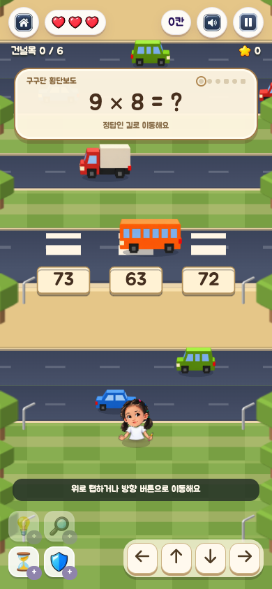

## 무작위 좀비 장애물 (2026-10-17)

- 디펜스 게임의 기존 좀비 스트립을 재사용했다. 각 잔디 구간에 1~2마리가 제자리에 서서 해당 칸으로의 진입을 막는다.
- 시작 칸과 퀴즈 입구·횡단보도·도착 안전지대는 비워 둔다. 새 판마다 위치가 달라진다.
- 배치 150판을 검사했고, 60판의 전체 경로를 실제 이동 함수로 실행해 건널목 6개를 모두 통과하는 것과 부활 지점이 좀비 칸에 놓이지 않는 것을 확인했다.
- 사방에서 접근해도 진입이 막히며, 이 동작으로 하트·보호막·점수·오답 횟수가 바뀌지 않는 것을 테스트했다.
- 390×844 브라우저에서 실제 오른쪽 방향키로 좀비 칸 진입을 시도했다. 위치와 하트는 유지되고 안내 문구와 해당 칸의 강조 표시가 나타났다.
- 이후 우회해 첫 퀴즈를 하트 3개로 통과했다. 일시정지 중 좀비 애니메이션과 차량 모두 멈추며 브라우저 오류가 없었다.

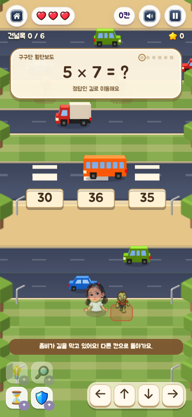

## 무한 진행·선물·가변 도로·묻힌 좀비 (2026-10-17)

- 결승선을 없앴다. 실제 브라우저에서 건널목 7개를 통과해도 플레이가 이어지고, 하트가 0이 되었을 때만 종료되는 것을 확인했다.
- 2·3·4차선 도로가 섞인다. 차선마다 다른 기본 속도에 난이도 배율을 적용한다. 3구간마다 난이도가 오르며 차량 속도·밀도·좀비 수는 플레이 가능한 범위로 제한한다.
- 실제 플레이에서 3차선과 4차선 도로를 통과하고 난이도 3까지 도달했다.
- 선물 4개를 실제로 수집했다. 보호막 획득과 8초 차량 감속, 효과 표시를 확인했다. 하트 회복·최대치·모든 랜덤 효과·중복 수집 방지·감속 시간 연장은 자동 테스트로 확인했다.
- 좀비 프레임의 위쪽 72px만 표시해 무릎 아래가 풀 속에 묻히도록 했다. 바닥 영역과 테두리를 제거했다. 캔버스의 실제 프레임 인수와 모바일 화면으로 확인했다.
- 500구간의 경로를 실제 이동 규칙으로 검사했고, 5000구간 규모의 생성 검사에서도 상태 버퍼 크기가 일정하게 유지되는 것을 확인했다.
- 실제 하트는 보호막 소진 뒤 2 → 1 → 0으로 줄었다. 종료 후 1260점·건널목 7개·선물 4개·별 2개 기록이 서버에 한 번 저장되고 Sparkles 6개를 받았다.
- 재시작 시 3하트·0칸·선물 0개·난이도 1로 초기화됐다. 320×568에서 가로 넘침이 없고 방향 버튼은 44×44px이다. 브라우저 오류 없음.
- 전체 자동 테스트 150개, JavaScript 모듈 로드·문법 검사, git diff --check 통과.

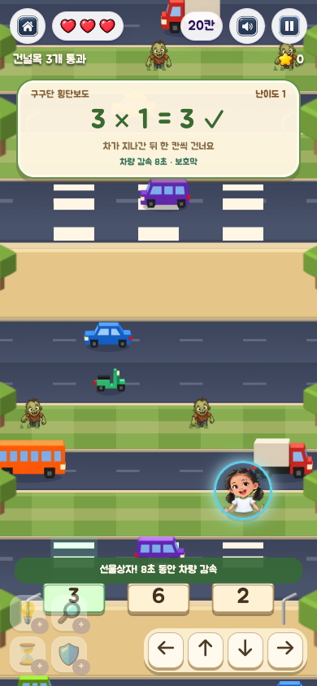

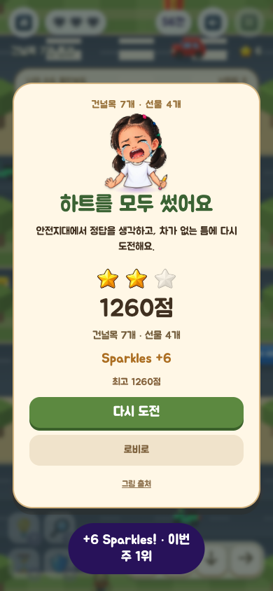

## 좀비를 바위로 교체 (2026-10-17)

- 좀비 이미지·애니메이션과 안내 문구를 단순한 입체 바위 SVG 및 바위 안내로 교체했다. 다른 게임의 좀비 에셋은 수정하지 않았다.
- 같은 시드 4개를 교체 전후 비교해 장애물 위치·개수와 선물 배치·효과가 동일한 것을 확인했다.
- 사방의 바위 진입 차단, 하트·보호막 유지, 우회 경로와 무한 생성 검사를 포함해 전체 자동 테스트 150개가 통과했다. JavaScript 문법 검사와 git diff --check도 통과했다.
- 실제 390×844 브라우저에서 오른쪽 바위 칸에 진입을 시도해 위치와 하트 3개가 유지되고 바위 안내가 표시되는 것을 확인했다. 이후 우회해서 첫 정답 건널목을 하트 3개로 통과했다.
- 320×568에서 가로 넘침이 없으며, 브라우저 오류·처리되지 않은 Promise 오류가 없었다.

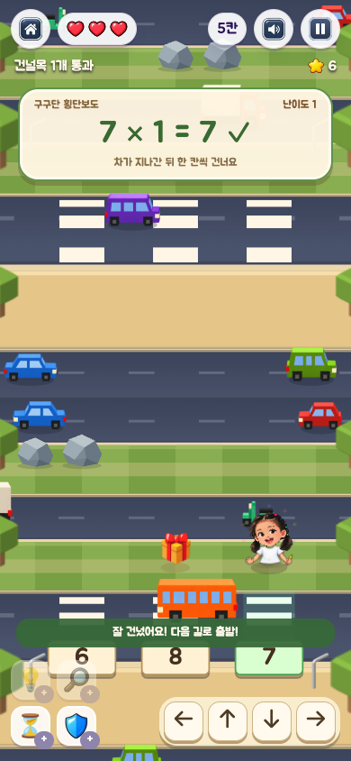

## 넓은 도로의 희귀 선물과 캐릭터 위 획득 연출 (2026-10-17)

- 선물을 기존 두 구간마다 한 개에서 다섯 구간마다 한 개로 줄였다. 다섯 구간 안에서 3차선 또는 4차선 도로를 무작위로 선택하고 안쪽 차선·열에 배치한다. 일반 안전지대와 퀴즈 횡단보도에는 생성하지 않는다.
- 시드 12개에 대해 각 100구간을 생성하여 빈도, 3·4차선 분포, 안쪽 차선 배치, 선물 사이 최소 간격을 검사했다. 도로 선물을 먹어도 부활 지점은 마지막 안전지대에 유지되고, 같은 선물을 두 번 받을 수 없다.
- 획득 아이콘·문구를 캐릭터 머리 위로 옮겼다. 하트·모래시계·보호막은 공통 UI 그림을 재사용하고 확대·반짝임·떠오름·페이드 연출을 2.2초간 표시한다. 일시정지는 게임 시간과 함께 연출을 멈추며, 종료·재시작은 표시를 정리한다.
- 남은 감속 시간과 보호막 상태는 질문창에서 제거하고 상단 진행 표시줄의 작은 아이콘으로 옮겼다.
- 실제 390×844 브라우저에서 건널목 네 개를 하트 3개로 통과해 4차선 도로 32행의 선물을 수집했다. 보호막 획득 팝업이 캐릭터 머리보다 위에 표시되는 것, 한 칸 이동할 때 x 좌표를 따라가는 것, 일시정지 0.9초 동안 위치·투명도가 유지되는 것, 재개 후 사라지는 것을 확인했다.
- 320×568에서 가로 넘침이 없고 보호막 상태가 질문창 밖에 유지된다. 브라우저 오류·처리되지 않은 Promise 오류 없음.
- 전체 자동 테스트 151개와 JavaScript 문법 검사, git diff --check 통과.

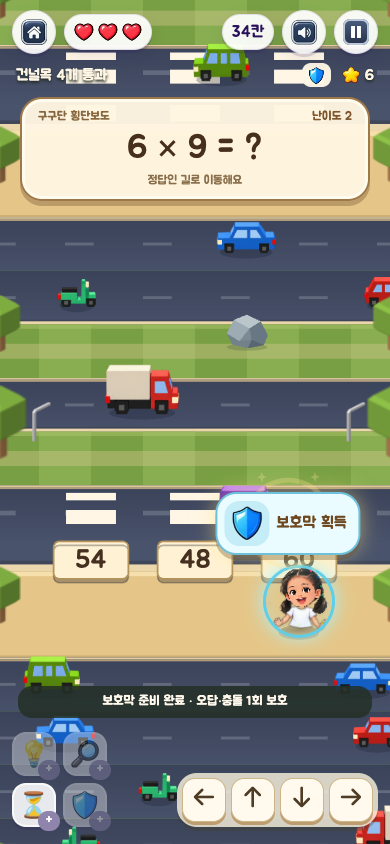

## 차량 가감속과 속도감 연출 (2026-10-17)

- 기본 주행 속도를 높이고, 넓은 도로의 흐름에 10% 속도 차이를 더했다. 차선별로 부드럽게 가속·감속하며 택시·스쿠터의 속도 반응이 버스·트럭보다 경쾌하다.
- 가속을 적분한 위치와 현재 속도를 함께 계산한다. 차량별 추가 변위는 제한되어 오래 플레이해도 같은 차선의 차량이 겹치지 않는다. 렌더링과 충돌 판정은 같은 위치를 사용한다.
- 빠른 차량 뒤에는 주행 방향에 맞는 속도선 세 개와 최대 7% 농도의 짧은 잔상을 표시한다. 차체 진동은 0.9px 이내이며 주 이미지의 크기·회전·기울임은 바꾸지 않는다. 실제 속도에 따라 연출 강도가 달라진다.
- 390×844 실제 브라우저에서 두 건널목을 하트 3개로 통과했다. 양쪽 주행 방향의 속도선과 잔상, 주 이미지의 완전한 불투명도·좌표 정렬을 캔버스 호출로 확인했다.
- 일시정지 0.45초 동안 두 캔버스가 그대로 유지됐다. 동작 줄이기 설정에서는 속도선과 잔상이 모두 0개가 되고 주 차량 36개는 선명하게 표시됐다.
- 실제 3차선 도로의 감속 선물을 획득했다. 획득 전 속도선 99개에서 감속 직후 속도선 0개·잔상 0개로 줄었고, 감속 효과 중에도 하트 3개로 다음 안전지대까지 이동했다. 브라우저 오류 없음.
- 320×568에서 가로 넘침 없이 연속 90프레임을 확인했고 브라우저 오류가 없었다.
- 가속 시 위치 연속성·속도 일치·양방향 전진·차량 간격·속도 상한, 감속 시 이동 거리 감소를 새 회귀 검사로 추가했다. 전체 자동 테스트 153개, JavaScript 문법 검사와 git diff --check 통과.

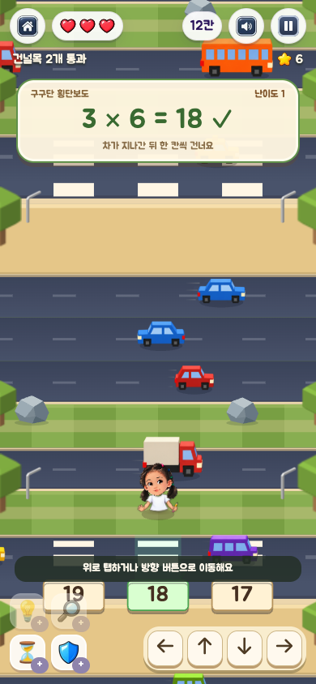

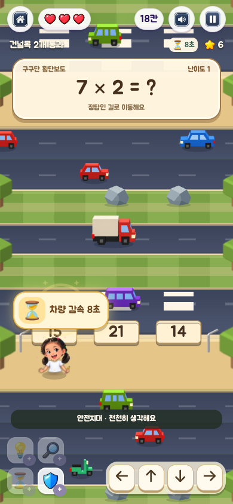

[실제 움직임 미리보기 · 40프레임, 약 3.6초](dynamic-traffic-preview.gif)

## 바위를 잔디 칸 세로 중앙으로 이동 (2026-10-17)

- 바위 그림을 표시 높이의 절반(월드 좌표 24.2~26.7px)만큼 아래로 내려 세로 중심을 잔디 칸 중앙에 맞췄다. 캐릭터와 겹칠 때의 앞뒤 순서도 내려간 그림 바닥에 맞췄다.
- 390×844 브라우저에서 실제 바위 이미지의 세로 중심이 해당 칸 중심과 일치하는 것을 캔버스 좌표로 확인했다. 오른쪽 바위 칸 진입이 차단되고 위치·하트 3개가 유지됐다.
- 320×568에서 가로 넘침과 브라우저 오류가 없다. JavaScript 문법 검사와 git diff --check 통과.

## 바위와 나무 장애물 혼합 (2026-10-17)

- 나무도 바위와 동일하게 해당 칸의 사방 진입을 막는다. 공통 장애물 목록과 판정으로 묶었으며 하트·보호막을 소모하지 않는다. 접근한 종류에 맞춰 바위 또는 나무 안내를 표시한다.
- 기존 총 장애물 수와 칸 위치를 유지한 채 바위와 나무를 섞었다. 두 개 이상이면 두 종류를 모두 배치하고, 이웃한 두 구간의 첫 장애물 종류는 서로 다르게 섞는다. 시드 20개의 교체 전후 장애물 칸·개수와 선물 데이터가 동일하다.
- 게임용 `obstacle-tree.svg`를 추가했다. 박스형 수관과 짧은 줄기의 단순한 형태로, 한 칸 안에 들어가며 바위와 같은 세로 중앙·앞뒤 정렬을 사용한다.
- 시드 20개에 대해 각각 100구간의 배치 비율을 검사했다. 모든 판에서 나무 비율이 40~60% 범위이며 총 장애물 수 제한을 지킨다. 기존 장기 이동·시작 칸·정답 길·부활 지점·선물 경로 검사도 통과했다.
- 390×844 실제 브라우저에서 왼쪽 바위와 오른쪽 나무 진입이 각각 차단되고, 하트 3개와 위치가 유지되는 것을 확인했다. 이후 우회해서 첫 정답 건널목을 하트 3개로 통과했다.
- 320×568에서 가로 넘침과 브라우저 오류가 없다. 전체 자동 테스트 154개, JavaScript 문법 검사와 git diff --check 통과.

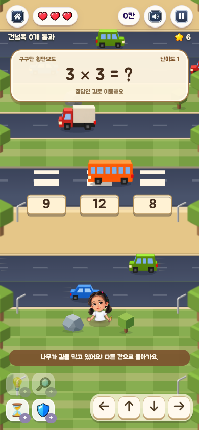

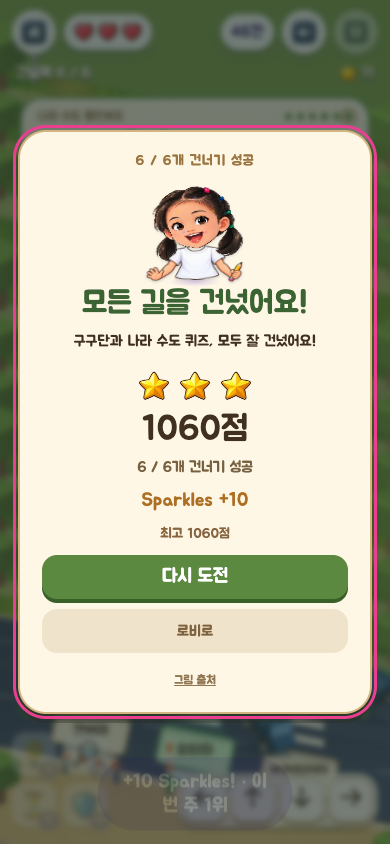

## 도로 배경음과 차량 통과음 (2026-10-17)

- DRAGON-STUDIO / Pixabay의 `Car Drive By Whoosh` MP3를 게임에 포함했다. 실제 파일은 2.04초·48kHz 스테레오·65,280바이트이며 브라우저에서 정상 디코딩·재생된다. 서버는 `audio/mpeg`로 제공한다. 출처·라이선스·원본 해시는 에셋 README와 게임 출처 창에 기록했다.
- 합성한 낮은 도로 배경음에 가까운 차량의 접근 시점에만 통과음을 더한다. 충돌·렌더링과 같은 위치·교통 시간을 사용하며 실제 방향에 따라 좌우로 이동한다. 실제 브라우저에서 좌우 양쪽 패닝과 속도별 재생 비율을 확인했다.
- 390×844 브라우저에서 음소거 중 게임은 계속 진행하지만 재생 소스와 출력 RMS가 모두 0이다. 소리를 다시 켜면 배경음이 재개되고 이전 통과음이 몰아서 나오지 않는다.
- 일시정지·탭 숨김·나가기 대화창에서 소스가 정리된다. 로비로 완전히 나간 뒤에도 재생 소스 0개이고 공유 AudioContext는 `running`으로 유지된다.
- 첫 건널목 통과 후 다음 퀴즈 앞에서 도로 채널 게인이 약 0.254로 낮아졌다. 정답 피드백 중 약 0.250을 유지하고, 두 번째 건널목을 건넌 뒤 약 0.983으로 복귀했다. 두 건널목을 통과하는 동안 브라우저 오류·처리되지 않은 Promise 오류가 없다.
- 자동 테스트 9개를 추가해 시작 전 무음, 근접 통과·좌우 방향, 중복·빈도 제한, 감속·퀴즈·음성 안내 중 음량, 음소거·정지·종료 정리, 늦은 로딩·실패·공유 컨텍스트 교체를 검사했다. 전체 163개 통과, JavaScript 문법 검사와 `git diff --check` 통과.
- 브라우저 검증은 음원 디코딩·오디오 노드·출력 신호를 측정했다. [실측 결과](traffic-audio-verification.json)에 각 상태의 게인·RMS·재생 소스와 오류 목록을 보존했다.
